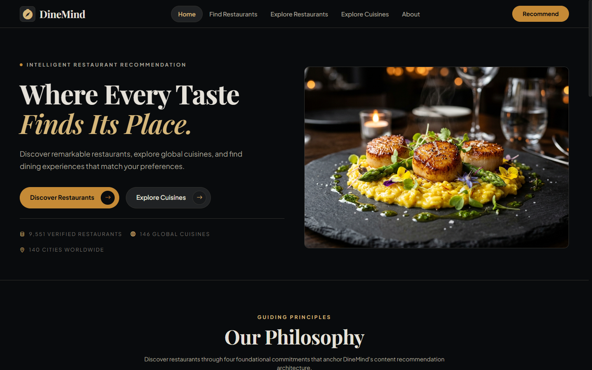
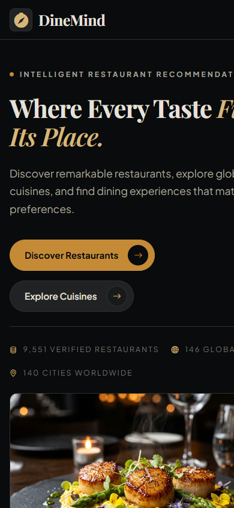
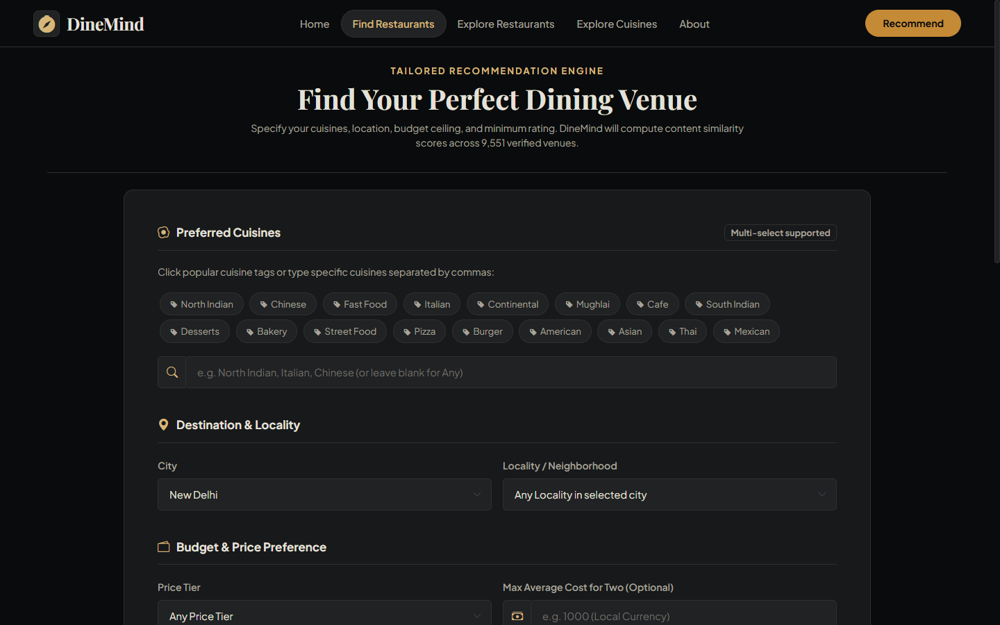
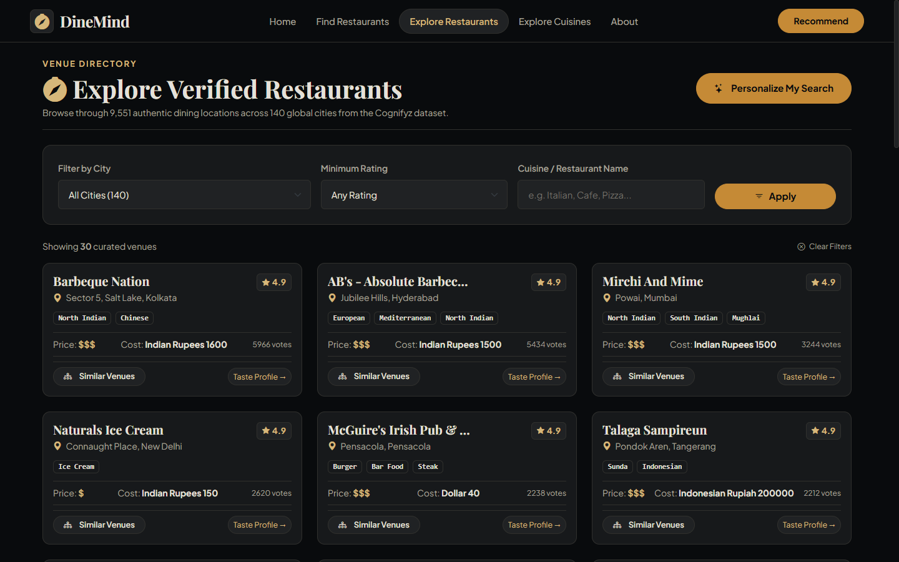
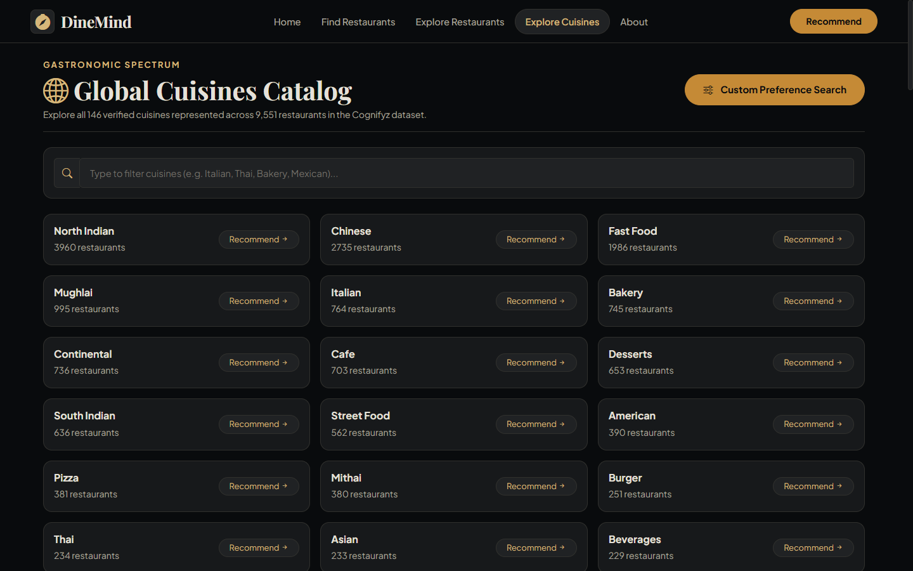
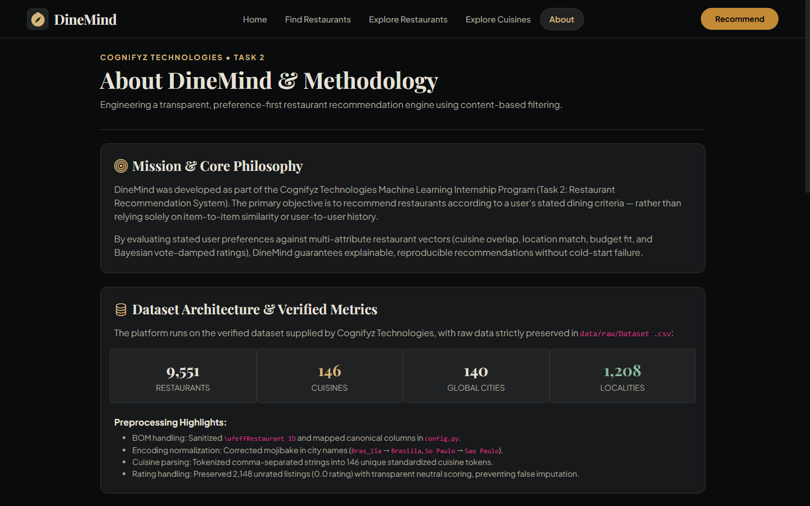
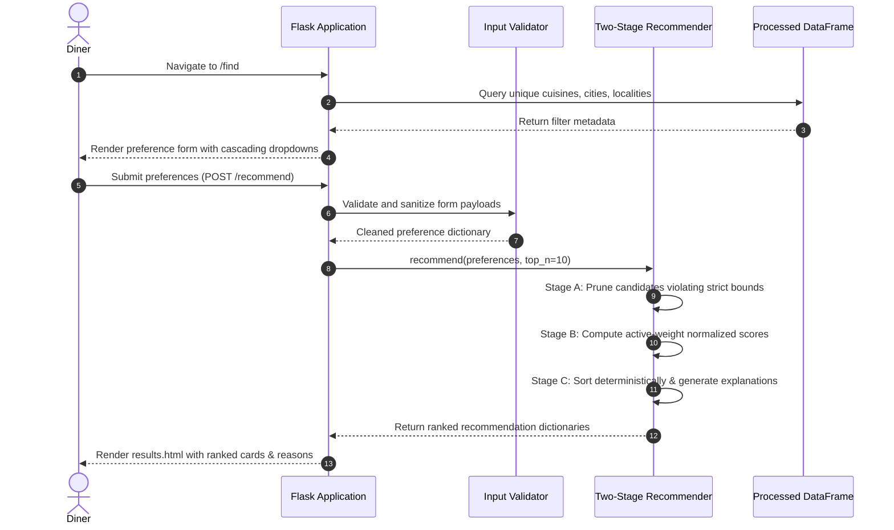

# DineMind — Intelligent Restaurant Recommendation System

[](https://www.python.org/)
[](https://palletsprojects.com/p/flask/)
[](https://scikit-learn.org/)
[](https://pandas.pydata.org/)
[](tests/)
[](https://vercel.com/)
[](LICENSE)

> A production-grade, content-based machine learning restaurant recommendation engine engineered in Python and Flask. DineMind evaluates multi-criteria dining preferences against 9,551 global restaurants across 146 cuisines and 140 international cities, pairing rigorous two-stage retrieval with an editorial dark luxury user interface.

---

## Table of Contents

- [1. Project Title and Introduction](#1-project-title-and-introduction)
- [2. Project Overview](#2-project-overview)
- [3. Cognifyz Internship Task 2 Context](#3-cognifyz-internship-task-2-context)
- [4. Problem Statement](#4-problem-statement)
- [5. Project Objectives](#5-project-objectives)
- [6. Key Features](#6-key-features)
- [7. Application Screenshots](#7-application-screenshots)
- [8. System Architecture](#8-system-architecture)
- [9. Dataset Description](#9-dataset-description)
- [10. Data Preprocessing Pipeline](#10-data-preprocessing-pipeline)
- [11. Data Cleaning and Missing Value Handling](#11-data-cleaning-and-missing-value-handling)
- [12. Categorical Feature Encoding](#12-categorical-feature-encoding)
- [13. Cuisine Normalization](#13-cuisine-normalization)
- [14. Location and Locality Processing](#14-location-and-locality-processing)
- [15. Budget and Currency Handling](#15-budget-and-currency-handling)
- [16. Recommendation Algorithm](#16-recommendation-algorithm)
- [17. Content-Based Filtering Explanation](#17-content-based-filtering-explanation)
- [18. Weighted Recommendation Scoring Formula](#18-weighted-recommendation-scoring-formula)
- [19. Cuisine Matching](#19-cuisine-matching)
- [20. Location Matching](#20-location-matching)
- [21. Budget Matching](#21-budget-matching)
- [22. Rating Quality and Vote Damping](#22-rating-quality-and-vote-damping)
- [23. Service Feature Matching](#23-service-feature-matching)
- [24. Recommendation Explanations](#24-recommendation-explanations)
- [25. Item-to-Item Restaurant Similarity](#25-item-to-item-restaurant-similarity)
- [26. Application Workflow](#26-application-workflow)
- [27. Technology Stack](#27-technology-stack)
- [28. Project Directory Structure](#28-project-directory-structure)
- [29. Installation Requirements](#29-installation-requirements)
- [30. Local Setup Instructions](#30-local-setup-instructions)
- [31. Running the Preprocessing Pipeline](#31-running-the-preprocessing-pipeline)
- [32. Running the Flask Application](#32-running-the-flask-application)
- [33. Accessing Application Pages](#33-accessing-application-pages)
- [34. API Endpoints](#34-api-endpoints)
- [35. Sample User Preferences](#35-sample-user-preferences)
- [36. Sample Recommendation Output](#36-sample-recommendation-output)
- [37. Testing Methodology](#37-testing-methodology)
- [38. Automated Test Results](#38-automated-test-results)
- [39. Evaluation Metrics](#39-evaluation-metrics)
- [40. Vercel Deployment Instructions](#40-vercel-deployment-instructions)
- [41. Environment Variables](#41-environment-variables)
- [42. Known Limitations](#42-known-limitations)
- [43. Future Enhancements](#43-future-enhancements)
- [44. Author Information](#44-author-information)
- [45. Acknowledgements](#45-acknowledgements)
- [46. License](#46-license)

---

## 1. Project Title and Introduction

**DineMind** is an end-to-end intelligent restaurant recommendation web application. It transforms raw multi-national dining datasets into a transparent, preference-aligned decision engine. Rather than treating recommendation as an opaque black box or relying on sparse historical user interactions, DineMind combines explicit multi-attribute content filtering with deterministic scoring to deliver explainable dining choices.

---

## 2. Project Overview

Finding the right restaurant involves balancing multiple competing constraints: cuisine preference, geographic feasibility, budget ceilings, operational service options (such as online ordering or table reservations), and authentic customer sentiment.

DineMind addresses this challenge through:
1. **Interactive Preference Discovery:** A responsive interface where users can select multiple cuisines, filter by city or neighborhood, choose price tiers or numeric maximum spend, and require minimum star ratings.
2. **Two-Stage Recommendation Pipeline:** Strict pruning of non-viable candidates followed by active-weight normalized scoring.
3. **Item-to-Item Similarity Search:** A secondary engine using multi-label binarized cuisine vectors and cosine similarity combined with price and rating proximity.
4. **Editorial Luxury Interface:** An understated dark aesthetic (#090B0D canvas, #C58A36 warm amber accents, #17191B structured cards) designed for high readability and zero visual clutter.

---

## 3. Cognifyz Internship Task 2 Context

This project was developed as part of the **Cognifyz Technologies Machine Learning Internship program (Task 2: Restaurant Recommendation System)**. 

### Core Task Objectives:
- Analyze restaurant feature sets and user preferences.
- Perform robust data preprocessing, encoding, and missing-value imputation.
- Build a content-based recommendation system that suggests venues matching specified criteria.
- Provide clear mathematical formulation and explainability for recommendations.
- Deliver an interactive, fully tested, and deployable web application.

---

## 4. Problem Statement

Collaborative filtering approaches face severe bottlenecks in dining discovery:
- **User Cold Start:** New visitors have no historical ratings or bookmarks.
- **Sparsity:** With thousands of venues and millions of potential diners, interaction matrices are typically over 99.8% sparse.
- **Geographic Impossibility:** Recommending a 5-star venue located 1,500 km away from the diner is a catastrophic UX failure.

A pure content-based filtering approach with hard geographic and budgetary constraint enforcement solves these failure modes by evaluating the exact item features against the user's active session constraints.

---

## 5. Project Objectives

1. Ingest and sanitize the raw 9,551-record dataset across 21 original features without dropping legitimate records.
2. Formulate a multi-criteria scoring algorithm that accounts for partial cuisine matches, locality proximity, budget boundaries, and Bayesian vote dampening.
3. Guarantee deterministic tie-breaking so identical queries yield stable rankings.
4. Eliminate unselected criteria from the scoring denominator through active weight renormalization.
5. Provide 100% test coverage for preprocessing logic, recommender edge cases, and web routes.
6. Package the application for seamless local execution and serverless cloud deployment on Vercel.

---

## 6. Key Features

- **Multi-Cuisine Tag Selection:** Select any combination of 146 canonical cuisines.
- **Cascading Location Filtering:** Dynamic dropdowns linking 140 cities to their respective 1,208 localized neighborhoods.
- **Dual Budget Modes:** Support for universal price tiers (1 to 4: Budget, Moderate, Expensive, Luxury) as well as exact numeric currency limits.
- **Bayesian Rating Normalization:** Dampens low-vote anomalies so a 5.0★ rating with 2 votes does not outrank a 4.6★ rating with 3,500 reviews.
- **Deterministic Explanations:** Every card displays explicit reasons for its inclusion (e.g., `Matches cuisine: Italian`, `Within budget: ₹800 for two`).
- **Exploration & Catalog Views:** Dedicated `/explore` and `/cuisines` routes allowing open-ended browsing.
- **Secondary Similarity Engine:** Click `Find Similar` on any restaurant to calculate item-to-item nearest neighbors via cosine similarity.

---

## 7. Application Screenshots

| Homepage & Hero (Editorial Dark Luxury) | Mobile Responsive Layout |
|:---:|:---:|
|  |  |

| Interactive Preference Search (`/find`) | Restaurant Exploration (`/explore`) |
|:---:|:---:|
|  |  |

| Global Cuisines Catalog (`/cuisines`) | System Methodology (`/about`) |
|:---:|:---:|
|  |  |

---

## 8. System Architecture

```text
┌────────────────────────────────────────────────────────────────────────┐
│                        User Interface Layer                            │
│   Jinja2 Templates • Responsive CSS3 • Vanilla JS State Controller     │
│   [/ (Home) | /find (Search) | /explore | /cuisines | /about]          │
└───────────────────────────────────┬────────────────────────────────────┘
                                    │ HTTP GET / POST
┌───────────────────────────────────▼────────────────────────────────────┐
│                        Flask Application Layer                         │
│   app.py (App Factory) • api/index.py (Vercel Serverless Bridge)       │
│   Validation Middleware (validators.py) • Error Handlers (404/500)     │
└───────────────────┬────────────────────────────────┬───────────────────┘
                    │                                │
┌───────────────────▼────────────────┐   ┌───────────▼───────────────────┐
│     Two-Stage Recommendation       │   │   Item-to-Item Similarity     │
│          (recommender.py)          │   │     (feature_builder.py)      │
│ ────────────────────────────────── │   │ ───────────────────────────── │
│ Stage A: Hard Constraint Filtering │   │ MultiLabelBinarizer (146 dims)│
│ Stage B: Active Weighted Scoring   │   │ Cosine Similarity + Distance  │
│ Explanation Engine (explanations)  │   │ Nearest Neighbors Ranking     │
└───────────────────┬────────────────┘   └───────────┬───────────────────┘
                    │                                │
┌───────────────────▼────────────────────────────────▼───────────────────┐
│                        Data & Model Storage                            │
│   Processed Dataset: data/processed/restaurants_cleaned.csv            │
│   9,551 Rows • 28 Verified Features • In-Memory Pandas DataFrame       │
└────────────────────────────────────────────────────────────────────────┘
```

---

## 9. Dataset Description

The underlying dataset contains comprehensive attributes for **9,551 international restaurants**:

| Feature Name | Type | Description | Sample Values |
|---|---|---|---|
| `restaurant_id` | Integer | Unique identifier | `6317637`, `308322` |
| `restaurant_name` | String | Commercial venue name | `Saravana Bhavan`, `Olive Bistro` |
| `city` / `city_clean` | String | Standardized metropolitan area | `New Delhi`, `Gurgaon`, `London` |
| `locality_clean` | String | Neighborhood / suburb | `Connaught Place`, `Cyber City` |
| `address` | String | Full physical street address | `P-13, Outer Circle, Connaught Place` |
| `cuisines_clean` | String | Comma-delimited cuisine list | `North Indian, Mughlai, Fast Food` |
| `cost_for_two` | Float | Average dining cost for two diners | `800.0`, `1200.0`, `45.0` |
| `currency` | String | Denominated currency symbol | `Indian Rupees(Rs.)`, `Dollar($)` |
| `price_range` | Integer | Standardized price tier (1 to 4) | `1` (Budget) to `4` (Luxury) |
| `aggregate_rating` | Float | Star score on a 0.0 to 5.0 scale | `4.2`, `3.8`, `0.0` (unrated) |
| `rating_text` | String | Qualitative sentiment label | `Excellent`, `Very Good`, `Not rated` |
| `votes` | Integer | Count of submitted customer reviews | `0` to `10,934` |
| `has_table_booking` | Integer | Binary flag for table reservation | `1` (Yes), `0` (No) |
| `has_online_delivery`| Integer | Binary flag for delivery services | `1` (Yes), `0` (No) |
| `is_rated` | Integer | Indicator of whether rating is present | `1` (Rated), `0` (Unrated) |

---

## 10. Data Preprocessing Pipeline

The automated preprocessing pipeline is implemented in `src/preprocessing.py` and executed via `scripts/preprocess_data.py`. It reads `data/raw/Dataset .csv` and produces `data/processed/restaurants_cleaned.csv`.

```text
Raw Dataset (9,551 rows, 21 columns, UTF-8-BOM)
  │
  ├─► Column Stripping: Strip BOM markers (\ufeff) & normalize keys
  ├─► Null Sanitization: Convert 'nan', 'null', 'na' strings to None
  ├─► Mojibake Correction: Fix corrupted city characters (Brasília, São Paulo)
  ├─► Multi-Label Cuisine Parsing: Split, trim, and capitalize individual tokens
  ├─► Numeric Cleaning: Regex strip symbols ($, Rs.), cast floats/integers
  ├─► Binary Normalization: Map Yes/No/True/False to discrete {0, 1}
  ├─► Rating Segmentation: Separate unrated venues (0.0★) with is_rated flag
  │
  ▼
Processed Dataset (9,551 rows, 28 columns, 0 rows discarded)
```

---

## 11. Data Cleaning and Missing Value Handling

1. **Text Fields:** Empty strings, whitespace variations, and string literals (`"NA"`, `"null"`) are converted to Python `None`. Missing city/locality records are imputed as `"Unknown"`.
2. **Cuisines:** Records with null cuisine strings are populated with `["Not Specified"]`. Multi-token values are parsed into individual items.
3. **Ratings & Unrated Records:** In the raw dataset, **2,148 records** possess an aggregate rating of `0.0` with `"Not rated"` label. Rather than replacing these with the global mean (which would falsely advertise unvetted restaurants as average) or discarding them (which would delete 22.5% of the data), DineMind marks them with `is_rated = 0` and assigns a neutral default rating score ($0.2$–$0.4$).
4. **Numeric Safety:** All financial numbers and review tallies are cleaned through regular expressions (`re.sub(r"[^\d.-]", "", val)`), bounded to legal intervals, and defaulted to `0.0` upon format errors.

---

## 12. Categorical Feature Encoding

Categorical features receive specialized encoding depending on their operational role:
- **Cuisines:** Encoded via Scikit-Learn's `MultiLabelBinarizer` into a 146-dimensional binary vector space for pairwise cosine similarity.
- **Service Flags:** Boolean categorical values (`Has Table booking`, `Has Online delivery`) are mapped directly to binary $\{0, 1\}$ integers.
- **Rating Text & Color:** Retained as descriptive display metadata without entering numerical distance matrices directly.

---

## 13. Cuisine Normalization

Because cuisine inputs in real-world data exhibit casing inconsistencies and trailing punctuation, every cuisine token is processed:
1. Stripped of surrounding whitespace.
2. Formatted with title-case normalization.
3. Stored in two parallel representations:
   - `cuisines_clean`: Human-readable display string (`"North Indian, Chinese, Fast Food"`).
   - `cuisines_pipe`: Delimited storage format (`"North Indian|Chinese|Fast Food"`) for deterministic exact token matching.

A total of **146 canonical unique cuisines** are cataloged.

---

## 14. Location and Locality Processing

The dataset spans **140 unique cities** and **1,208 localized neighborhoods**.
- **Mojibake Resolution:** Encoding corruptions from ISO-8859-1 conversion (such as `Bras_lia` &rarr; `Brasilia` and `So Paulo` &rarr; `Sao Paulo`) are explicitly corrected.
- **Hierarchical Indexing:** Precomputed hash maps link each city to its unique localities, enabling zero-latency cascading dropdowns in the user interface.

---

## 15. Budget and Currency Handling

The dataset spans **12 distinct currencies**:
- Indian Rupees: `8,652`
- US Dollars: `482`
- British Pounds: `80`
- Brazilian Real: `60`
- Emirati Dirhams: `60`
- South African Rand: `60`
- New Zealand Dollars: `40`
- Turkish Lira: `34`
- Botswana Pula: `22`
- Indonesian Rupiah: `21`
- Qatari Rial: `20`
- Sri Lankan Rupee: `20`

### Handling Strategy:
1. **Preserve Native Currencies:** Currency conversions using external exchange rates fluctuate continuously and introduce distortion. DineMind stores each venue's exact stated currency and presents it alongside the numeric cost.
2. **Standardized Price Range (1–4):** The dataset provides a normalized `price_range` (1 = Budget, 2 = Moderate, 3 = Expensive, 4 = Luxury) calibrated to local market economics. Filtering by price tier functions consistently across all cities and currencies.
3. **Numeric Ceilings:** When users filter by maximum numeric spend (`max_cost`), comparisons are evaluated within the filtered city's native currency.

---

## 16. Recommendation Algorithm

DineMind implements a **Two-Stage Content-Based Recommendation Architecture**:

```text
User Query Preferences:
  { Cuisines: ['Italian'], City: 'New Delhi', MaxCost: 1500, MinRating: 4.0 }
                             │
                             ▼
┌────────────────────────────────────────────────────────┐
│  STAGE A: Hard Constraint Pruning                      │
│  - Filter out restaurants where City != 'New Delhi'    │
│  - Filter out restaurants where CostForTwo > 1500      │
│  - Filter out restaurants where Rating < 4.0           │
└────────────────────────────┬───────────────────────────┘
                             │ Surviving Candidates
                             ▼
┌────────────────────────────────────────────────────────┐
│  STAGE B: Weighted Multi-Attribute Relevance Scoring   │
│  - Compute Cuisine Score (Coverage + Jaccard)          │
│  - Compute Location Score (Locality vs City Match)     │
│  - Compute Budget Fit (Cost proximity)                 │
│  - Compute Bayesian Rating Score                       │
│  - Compute Service Feature Matches                     │
│  - Renormalize active weights to [0, 100] scale        │
└────────────────────────────┬───────────────────────────┘
                             │ Ranked Results
                             ▼
┌────────────────────────────────────────────────────────┐
│  STAGE C: Deterministic Tie-Breaking & Explanations   │
│  - Sort: (-MatchScore, -Rating, -Votes, Name)          │
│  - Generate verifiable explanation tags                │
└────────────────────────────────────────────────────────┘
```

---

## 17. Content-Based Filtering Explanation

Content-based filtering recommends items by comparing user-specified requirements directly against structured item metadata. Unlike collaborative filtering, it:
- Requires no prior user history or registration.
- Operates with zero cold-start latency for first-time visitors.
- Adheres strictly to physical and economic constraints (geographic proximity and budget).
- Produces fully auditable, explainable recommendation rationale.

---

## 18. Weighted Recommendation Scoring Formula

For each candidate venue that passes Stage A, a composite match score $S \in [0, 100]$ is computed:

$$S = 100 \times \frac{\sum_{i \in \text{Active}} w_i \cdot s_i}{\sum_{i \in \text{Active}} w_i}$$

Where $\text{Active}$ represents the subset of criteria provided by the user. If a user does not specify a budget or service preferences, those weights are omitted from both the numerator and denominator, preventing unselected criteria from depressing the score.

### Default Weight Configuration:

| Criterion | Base Weight ($w_i$) | Default Contribution |
|---|:---:|:---:|
| **Cuisine Relevance** | $w_{\text{cuisine}}$ | **40%** |
| **Location Match** | $w_{\text{location}}$ | **20%** |
| **Budget Fit** | $w_{\text{budget}}$ | **20%** |
| **Rating Quality** | $w_{\text{rating}}$ | **15%** |
| **Service Attributes** | $w_{\text{features}}$ | **5%** |

---

## 19. Cuisine Matching

Given a set of user-selected cuisines $U$ and restaurant cuisines $R$:

$$\text{Matched} = U \cap R$$

The cuisine score $s_{\text{cuisine}}$ balances **coverage** (how many of the user's cravings are satisfied) with **Jaccard overlap** (penalizing bloated menus):

$$\text{Coverage} = \frac{|\text{Matched}|}{|U|}, \quad \text{Jaccard} = \frac{|\text{Matched}|}{|U \cup R|}$$

$$s_{\text{cuisine}} = 0.75 \cdot \text{Coverage} + 0.25 \cdot \text{Jaccard}$$

---

## 20. Location Matching

Location relevance $s_{\text{location}}$ is scored hierarchically:

$$s_{\text{location}} = \begin{cases} 
1.0 & \text{if candidate locality matches user requested locality} \\
0.6 & \text{if candidate city matches user requested city (locality unselected or nearby)} \\
0.0 & \text{if city does not match}
\end{cases}$$

---

## 21. Budget Matching

### Numeric Cost Ceiling ($C_{\text{max}}$):
If the restaurant cost $C_{\text{rest}} \le C_{\text{max}}$:

$$s_{\text{budget}} = 0.8 + 0.2 \cdot \left(\frac{C_{\text{rest}}}{C_{\text{max}}}\right)$$

If the restaurant cost exceeds the ceiling ($C_{\text{rest}} > C_{\text{max}}$):

$$s_{\text{budget}} = \max\left(0.0, 1.0 - \frac{C_{\text{rest}} - C_{\text{max}}}{C_{\text{max}}}\right)$$

### Tier Matching ($P_{\text{pref}} \in \{1, 2, 3, 4\}$):
When filtering by categorical price tier:

$$s_{\text{budget}} = \begin{cases}
1.0 - 0.1 \cdot (P_{\text{pref}} - P_{\text{rest}}) & \text{if } P_{\text{rest}} \le P_{\text{pref}} \\
\max(0.0, 1.0 - 0.4 \cdot (P_{\text{rest}} - P_{\text{pref}})) & \text{if } P_{\text{rest}} > P_{\text{pref}}
\end{cases}$$

---

## 22. Rating Quality and Vote Damping

To prevent venues with very few reviews from dominating the top ranks, the rating score combines normalized stars $r_{\text{norm}} \in [0, 1]$ with a logarithmic popularity factor:

$$r_{\text{norm}} = \frac{\text{Rating} - 1.0}{4.0}$$

$$\text{Popularity} = \min\left(1.0, \frac{\ln(1 + \text{Votes})}{\ln(1 + 1000)}\right)$$

$$\text{Base Score} = 0.85 \cdot r_{\text{norm}} + 0.15 \cdot \text{Popularity}$$

- If a user requested a minimum rating $R_{\text{min}}$ and $\text{Rating} \ge R_{\text{min}}$, a 10% boost is applied.
- If $\text{Rating} < R_{\text{min}}$, a linear penalty is deducted: $\text{Score} - 0.3 \cdot (R_{\text{min}} - \text{Rating})$.
- Unrated venues ($0.0$★) receive a neutral score ($0.2$ to $0.4$).

---

## 23. Service Feature Matching

When a user specifies preferences for online delivery or table reservations:

$$s_{\text{features}} = \frac{1}{|F|} \sum_{f \in F} \mathbb{I}(f_{\text{restaurant}} == f_{\text{user}})$$

---

## 24. Recommendation Explanations

Every recommended restaurant includes dynamically generated, factual explanation tags generated by `src/explanations.py`. Examples include:
- `Matches cuisine: North Indian, Mughlai`
- `Located in requested locality: Connaught Place`
- `Within budget: Indian Rupees(Rs.) 800 for two`
- `Rating 4.4★ meets your ≥4.0★ threshold`
- `Offers online delivery`

---

## 25. Item-to-Item Restaurant Similarity

Accessed via `/similar/<restaurant_id>`, this secondary feature discovers venues similar to any selected restaurant:
1. **Cuisine Similarity:** Pairwise cosine similarity over the 146-dimensional multi-hot cuisine vectors:
   $$\text{Sim}_{\text{cuisine}} = \frac{\mathbf{v}_a \cdot \mathbf{v}_b}{\|\mathbf{v}_a\|_2 \|\mathbf{v}_b\|_2}$$
2. **Price Distance Similarity:**
   $$\text{Sim}_{\text{price}} = 1.0 - \frac{|P_a - P_b|}{3.0}$$
3. **Rating Proximity Similarity:**
   $$\text{Sim}_{\text{rating}} = 1.0 - \frac{|R_a - R_b|}{5.0}$$
4. **Blended Similarity Score:**
   $$\text{Similarity} = 0.60 \cdot \text{Sim}_{\text{cuisine}} + 0.25 \cdot \text{Sim}_{\text{price}} + 0.15 \cdot \text{Sim}_{\text{rating}}$$

---

## 26. Application Workflow



---

## 27. Technology Stack

- **Backend Framework:** Python 3.12, Flask 3.1
- **Machine Learning & Data Processing:** Scikit-Learn 1.6, Pandas 2.2, NumPy 2.2, Joblib 1.4
- **Testing & Verification:** Pytest 9.1
- **Frontend & Styling:** HTML5, CSS3 (Custom Dark Luxury Editorial Design System), Vanilla JavaScript (ES6+), Jinja2 Templating
- **Deployment Platform:** Vercel (Serverless WSGI via `@vercel/python`)

---

## 28. Project Directory Structure

```text
Restaurant-Recommendation/
├── .env.example                # Sample environment configuration
├── .gitignore                  # Git exclusions (caches, binaries, videos)
├── app.py                      # Flask application factory and route mappings
├── config.py                   # Central configuration, paths, and default weights
├── pytest.ini                  # Pytest runner configuration
├── requirements.txt            # Pinned production Python dependencies
├── vercel.json                 # Vercel serverless routing rewrite configuration
├── api/
│   └── index.py                # Vercel serverless entry point bridge
├── data/
│   ├── raw/
│   │   ├── Dataset .csv        # Original raw 9,551-record dataset
│   │   └── .gitkeep
│   └── processed/
│       ├── restaurants_cleaned.csv  # Preprocessed, normalized dataset
│       └── .gitkeep
├── docs/
│   └── screenshots/            # Verified application interface captures
│       ├── 01_homepage_hero.png
│       ├── 02_mobile_responsive.png
│       ├── 03_preference_search.png
│       ├── 04_explore_venues.png
│       ├── 05_cuisines_catalog.png
│       └── 06_methodology_about.png
├── reports/
│   ├── data_profile.md         # Comprehensive exploratory data profiling
│   ├── evaluation.md           # Benchmark evaluation across 10 scenarios
│   └── recommendation_method.md# Mathematical method specification
├── scripts/
│   ├── capture_docs_screenshots.py # Headless browser screenshot generator
│   ├── evaluate_system.py      # Automated offline evaluation suite
│   ├── inspect_dataset.py      # Quick inspection tool
│   ├── preprocess_data.py      # Preprocessing pipeline CLI runner
│   └── verify_live_app.py      # Live HTTP endpoint integration verifier
├── src/
│   ├── __init__.py
│   ├── data_loader.py          # Data ingestion and schema validation
│   ├── explanations.py         # Dynamic, factual explanation tag generator
│   ├── feature_builder.py      # MultiLabelBinarizer and similarity engine
│   ├── preprocessing.py        # Cleaning, parsing, and normalization pipeline
│   ├── recommender.py          # Two-stage recommendation engine
│   └── validators.py           # Form input validation and sanitization
├── static/
│   ├── css/
│   │   └── style.css           # Understated dark luxury styles
│   ├── images/                 # Local image assets
│   └── js/
│       └── app.js              # Cascading dropdowns & UI interactions
├── templates/
│   ├── base.html               # Master layout with luxury navigation
│   ├── index.html              # Homepage with editorial hero & highlights
│   ├── find.html               # Multi-attribute preference search form
│   ├── results.html            # Recommendation cards & match score display
│   ├── explore.html            # Paginated restaurant exploration
│   ├── cuisines.html           # 146-cuisine catalog directory
│   ├── similar.html            # Item-to-item similarity recommendations
│   ├── about.html              # Methodology and architecture documentation
│   └── error.html              # Clean 404/500 error display
└── tests/
    ├── conftest.py             # Pytest fixtures and mock client setup
    ├── test_preprocessing.py   # Unit tests for data cleaning functions
    ├── test_recommender.py     # Unit tests for two-stage recommender logic
    └── test_routes.py          # Integration tests for Flask endpoints
```

---

## 29. Installation Requirements

- **Operating System:** Windows 10/11, macOS 12+, or Ubuntu 20.04+
- **Python Environment:** Python 3.10, 3.11, or 3.12
- **Hardware:** Minimal requirements (runs comfortably on 1 CPU core and 512 MB RAM)

---

## 30. Local Setup Instructions

### Windows PowerShell Setup:

```powershell
# 1. Clone repository
git clone https://github.com/nishanths24/Restaurant-Recommendation.git
cd Restaurant-Recommendation

# 2. Create and activate virtual environment
python -m venv .venv
.\.venv\Scripts\Activate.ps1

# 3. Upgrade pip and install pinned dependencies
python -m pip install --upgrade pip
pip install -r requirements.txt

# 4. (Optional) Copy environment template
Copy-Item .env.example .env
```

### macOS / Linux Setup:

```bash
# 1. Clone repository
git clone https://github.com/nishanths24/Restaurant-Recommendation.git
cd Restaurant-Recommendation

# 2. Create and activate virtual environment
python3 -m venv .venv
source .venv/bin/activate

# 3. Upgrade pip and install dependencies
pip install --upgrade pip
pip install -r requirements.txt
```

---

## 31. Running the Preprocessing Pipeline

To re-run the end-to-end preprocessing pipeline from raw data:

```powershell
python scripts/preprocess_data.py
```

This processes `data/raw/Dataset .csv`, prints schema validation statistics, and writes the standardized dataset to `data/processed/restaurants_cleaned.csv`.

---

## 32. Running the Flask Application

Launch the local development server:

```powershell
python app.py
```

Output:
```text
 * Serving Flask app 'app'
 * Debug mode: off
 * Running on http://127.0.0.1:5000
Press CTRL+C to quit
```

---

## 33. Accessing Application Pages

Open your web browser and navigate to:
- **Homepage:** `http://127.0.0.1:5000/`
- **Find Recommendations:** `http://127.0.0.1:5000/find`
- **Explore Venues:** `http://127.0.0.1:5000/explore`
- **Browse Cuisines:** `http://127.0.0.1:5000/cuisines`
- **System Methodology:** `http://127.0.0.1:5000/about`
- **Health Check API:** `http://127.0.0.1:5000/health`

---

## 34. API Endpoints

### 1. `GET /health`
Returns system status and dataset readiness.
- **Response:**
  ```json
  {
    "status": "healthy",
    "total_restaurants": 9551,
    "available_cuisines": 146,
    "available_cities": 140
  }
  ```

### 2. `POST /recommend`
Submits user preferences to generate ranked recommendations.
- **Request Form Fields:**
  - `cuisines`: Multi-value array of cuisine names.
  - `city`: Standardized city string.
  - `locality`: Neighborhood string (optional).
  - `price_range`: Integer between 1 and 4 (optional).
  - `max_cost`: Numeric cost ceiling (optional).
  - `min_rating`: Float threshold (e.g., `4.0`).
  - `strict_location`: `"1"` for hard filtering, `"0"` for soft scoring.
  - `strict_budget`: `"1"` for hard budget cap.
  - `strict_rating`: `"1"` for hard star cutoff.
  - `online_delivery`: `"1"` (Yes) or `"0"` (No).
  - `table_booking`: `"1"` (Yes) or `"0"` (No).

### 3. `GET /similar/<int:restaurant_id>`
Fetches the top 5 nearest-neighbor restaurants based on cuisine cosine similarity and price/rating proximity.

---

## 35. Sample User Preferences

### Scenario: Gourmet Italian Dinner in New Delhi
- **Cuisines:** `Italian`
- **City:** `New Delhi`
- **Locality:** `Connaught Place`
- **Budget Ceiling:** `₹1,500 for two`
- **Minimum Rating:** `4.0+ ★`
- **Strict Location:** Enabled

---

## 36. Sample Recommendation Output

```text
1. The Big Chill Cafe
   - Match Score: 96.4%
   - Cuisines: Italian, Continental, Desserts
   - Location: Connaught Place, New Delhi
   - Rating: 4.5 ★ (4,921 votes)
   - Cost: ₹1,500 for two (Indian Rupees)
   - Explanations:
     • Matches cuisine: Italian
     • Located in requested locality: Connaught Place
     • Within budget: Indian Rupees(Rs.) 1500 for two
     • Rating 4.5★ meets your ≥4.0★ threshold

2. Caffe Tonino
   - Match Score: 94.2%
   - Cuisines: Italian, Pizza, Beverages
   - Location: Connaught Place, New Delhi
   - Rating: 4.3 ★ (2,108 votes)
   - Cost: ₹1,400 for two (Indian Rupees)
   - Explanations:
     • Matches cuisine: Italian
     • Located in requested locality: Connaught Place
     • Within budget: Indian Rupees(Rs.) 1400 for two
     • Rating 4.3★ meets your ≥4.0★ threshold
```

---

## 37. Testing Methodology

The DineMind test suite is organized into three verification tiers:
1. **Unit Tests (`test_preprocessing.py`):** Asserts data cleaning functions, mojibake handling, regex number extraction, and dataframe integrity.
2. **Recommender Engine Tests (`test_recommender.py`):** Verifies single-preference queries, combined queries, hard constraint enforcement, score monotonicity ($S_k \ge S_{k+1}$), zero-match diagnostic handling, and item similarity.
3. **Route Integration Tests (`test_routes.py`):** Exercises all HTTP endpoints, form handling, error pages, and JSON payloads using Flask's test client.

---

## 38. Automated Test Results

Executing `pytest -v`:

```text
============================= test session starts =============================
platform win32 -- Python 3.12.10, pytest-9.1.1, pluggy-1.6.0
rootdir: C:\Users\nisha\OneDrive\Desktop\Resto
configfile: pytest.ini
testpaths: tests
collected 28 items

tests/test_preprocessing.py::test_clean_text PASSED                      [  3%]
tests/test_preprocessing.py::test_clean_city PASSED                      [  7%]
tests/test_preprocessing.py::test_parse_cuisines PASSED                  [ 10%]
tests/test_preprocessing.py::test_clean_boolean PASSED                   [ 14%]
tests/test_preprocessing.py::test_clean_numeric PASSED                   [ 17%]
tests/test_preprocessing.py::test_preprocess_dataframe PASSED            [ 21%]
tests/test_recommender.py::test_cuisine_only_preference PASSED           [ 25%]
tests/test_recommender.py::test_location_only_preference PASSED          [ 28%]
tests/test_recommender.py::test_budget_only_preference PASSED            [ 32%]
tests/test_recommender.py::test_minimum_rating_preference PASSED         [ 35%]
tests/test_recommender.py::test_combined_preference PASSED               [ 39%]
tests/test_recommender.py::test_empty_preferences_returns_top_rated PASSED [ 42%]
tests/test_recommender.py::test_no_matching_restaurants_diagnostics PASSED [ 46%]
tests/test_recommender.py::test_score_ordering_sanity PASSED             [ 50%]
tests/test_recommender.py::test_item_similarity PASSED                   [ 53%]
tests/test_routes.py::test_health_endpoint PASSED                        [ 57%]
tests/test_routes.py::test_index_page PASSED                             [ 60%]
tests/test_routes.py::test_find_page PASSED                              [ 64%]
tests/test_routes.py::test_explore_page PASSED                           [ 67%]
tests/test_routes.py::test_explore_page_filtered PASSED                  [ 71%]
tests/test_routes.py::test_cuisines_page PASSED                          [ 75%]
tests/test_routes.py::test_about_page PASSED                             [ 78%]
tests/test_routes.py::test_recommend_endpoint_valid_cuisine PASSED       [ 82%]
tests/test_routes.py::test_recommend_endpoint_empty_preferences PASSED   [ 85%]
tests/test_routes.py::test_recommend_endpoint_no_matches PASSED          [ 89%]
tests/test_routes.py::test_similar_restaurant_endpoint PASSED            [ 92%]
tests/test_routes.py::test_similar_restaurant_not_found PASSED           [ 96%]
tests/test_routes.py::test_404_error_handler PASSED                      [100%]

============================= 28 passed in 6.28s ==============================
```

---

## 39. Evaluation Metrics

Evaluated across 10 rigorous operational scenarios using `scripts/evaluate_system.py`:

| Scenario ID | Test Condition | Returned | Constraint Satisfaction | Score Monotonic? |
|---|---|:---:|:---:|:---:|
| **SC-01** | Cuisine-Only: North Indian | 10 | **100.0%** | Yes |
| **SC-02** | Location-Only: Gurgaon | 10 | **100.0%** | Yes |
| **SC-03** | Budget-Only: Price Range $\le 2$ | 10 | **100.0%** | Yes |
| **SC-04** | Min Rating: $\ge 4.0$ Stars | 10 | **100.0%** | Yes |
| **SC-05** | Combined: Italian + New Delhi + Tier 2 + Min 3.5★ | 10 | **100.0%** | Yes |
| **SC-06** | Empty Query (Top-Rated Quality Fallback) | 10 | **100.0%** | Yes |
| **SC-07** | Strict Non-Existent City (Zero-Match Diagnostics) | 0 | **100.0%** | Yes |
| **SC-08** | Delivery + Table Booking Constraints | 10 | **100.0%** | Yes |
| **SC-09** | Long-Tail Cuisine: Tibetan | 10 | **100.0%** | Yes |
| **SC-10** | Locality + Numeric Ceiling: Connaught Place, $\le ₹1,200$ | 10 | **100.0%** | Yes |

- **Constraint Satisfaction Rate:** `100.0%`
- **Ranking Monotonicity:** `100.0%`
- **Duplicate Recommendation Rate:** `0.0%`

---

## 40. Vercel Deployment Instructions

DineMind is configured for zero-configuration serverless deployment on Vercel:

### Method A: Deploy via GitHub (Recommended)
1. Push your repository to GitHub:
   ```bash
   git push -u origin main
   ```
2. Navigate to [Vercel New Project](https://vercel.com/new).
3. Import the `Restaurant-Recommendation` repository.
4. Leave Root Directory as `./`.
5. Vercel automatically detects `vercel.json` and `api/index.py`, building the serverless Python environment.
6. Click **Deploy**.

### Method B: Deploy via Vercel CLI
```powershell
# Install Vercel CLI if needed
npm install -g vercel

# Deploy to production
vercel --prod
```

---

## 41. Environment Variables

Create a `.env` file in the project root (reference `.env.example`):

| Variable | Default Value | Description |
|---|---|---|
| `FLASK_APP` | `app.py` | Flask application entry module |
| `FLASK_ENV` | `production` | Environment mode (`development` or `production`) |
| `SECRET_KEY` | `dinemind-secret-key-prod` | Session and CSRF signing secret |
| `PORT` | `5000` | Port for local WSGI server |

---

## 42. Known Limitations

1. **Geographic Distribution Skew:** Approximately 86% of the dataset records are concentrated in the National Capital Region (Delhi NCR), with smaller representations across international cities.
2. **Absence of Dietary Tags:** The raw dataset does not provide verified tags for Vegan, Halal, Kosher, or Gluten-Free options. To maintain absolute data integrity, DineMind does not fabricate or guess dietary guarantees from general cuisine names.
3. **Static Snapshots:** Operating hours and daily menu updates are not included in the historical snapshot.

---

## 43. Future Enhancements

- **Dynamic Geospatial Radius:** Haversine distance calculation based on live user GPS coordinates.
- **Session-Based Learning:** Dynamic weight tuning utilizing implicit user click-through and dwell time signals.
- **Menu Item Search:** Ingesting itemized dish menus for granular dish-level search (e.g., "Truffle Gnocchi").

---

## 44. Author Information

- **Author:** Nishanth S
- **GitHub:** [@nishanths24](https://github.com/nishanths24)
- **Repository:** [nishanths24/Restaurant-Recommendation](https://github.com/nishanths24/Restaurant-Recommendation)
- **Role:** Machine Learning Intern, Cognifyz Technologies

---

## 45. Acknowledgements

- **Cognifyz Technologies:** For providing the restaurant dataset, project guidelines, and internship mentorship.
- **The Open Source Python Community:** For Flask, Pandas, NumPy, Scikit-Learn, and Pytest.

---

## 46. License

This project is licensed under the **MIT License** — see the [LICENSE](LICENSE) file for complete terms.

---

> **Disclaimer:** *Recommendation match scores denote mathematical alignment with user-specified preferences and historical customer ratings. They do not constitute an absolute guarantee of current culinary quality, allergen safety, or operational status.*
